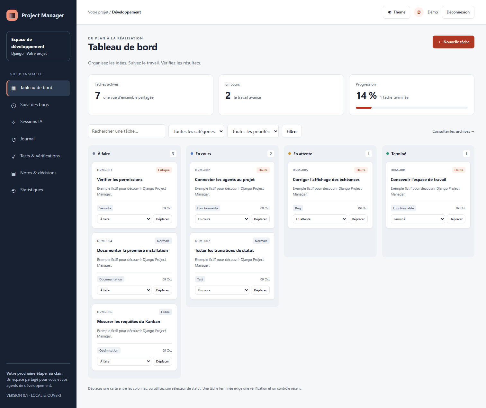

# Django Project Manager

Un espace de développement en français pour vos projets Django et vos agents IA.
Kanban, sous-tâches, critères d’acceptation, journal, sessions IA, tests et décisions
techniques : tout reste dans votre base de données, sans API IA imposée.



**MVP 0.1.0**, licence MIT. Application réutilisable compatible Django **5.2, 6.0 et
6.1**, Python ≥ 3.10 pour Django 5.2 et ≥ 3.12 pour Django 6.x. SQLite par défaut,
PostgreSQL via les paramètres Django de votre projet. Les branches maintenues ont
été vérifiées le 9 octobre 2026 sur la [page officielle Django](https://www.djangoproject.com/download/).

## Essayer en cinq minutes

Décompressez le dépôt, ouvrez un terminal dans le dossier contenant `manage.py`.
Python doit être installé ; consultez le [guide débutant](docs/installation.md).

Windows PowerShell :

```powershell
py -m venv .venv
.\.venv\Scripts\python.exe -m pip install -e .
.\.venv\Scripts\python.exe manage.py migrate
.\.venv\Scripts\python.exe manage.py createsuperuser
.\.venv\Scripts\python.exe manage.py dpm_demo --actor votre_identifiant
.\.venv\Scripts\python.exe manage.py runserver
```

Linux :

```bash
python3 -m venv .venv
.venv/bin/python -m pip install -e .
.venv/bin/python manage.py migrate
.venv/bin/python manage.py createsuperuser
.venv/bin/python manage.py dpm_demo --actor votre_identifiant
.venv/bin/python manage.py runserver
```

Ouvrez **http://127.0.0.1:8000/project/** et connectez-vous. Les exemples sont
fictifs et facultatifs. Aucun mot de passe par défaut n’est créé. Le thème suit
votre système et peut être modifié avec le bouton « Thème ».

## Installer dans un projet existant

Le paquet n’est pas encore publié sur PyPI. Installez le dossier local ou le wheel
fourni : `python -m pip install /chemin/vers/django-project-manager`.
Après publication sur PyPI, la commande sera `python -m pip install django-project-manager`.
N’installez pas un homonyme éventuel en supposant qu’il s’agit de ce dépôt.

Ajoutez `"django_project_manager"` à `INSTALLED_APPS`, puis :

```python
(path("project/", include("django_project_manager.urls")),)
```

Exécutez `python manage.py migrate`. Votre configuration, votre modèle utilisateur,
votre base et vos applications existantes restent ceux du projet hôte.
Le [guide d’installation](docs/installation.md) détaille les prérequis et permissions.

## Ce que permet le MVP

- Kanban en quatre colonnes, déplacement par glisser-déposer ou sélecteur accessible.
- Recherche, filtres catégorie/priorité, archives, statistiques et échéances.
- Création, édition, suppression confirmée, archivage et restauration des tâches.
- Sous-tâches, critères vérifiés, références Git et contrôles datés.
- Historique conservé après suppression, sessions IA, notes et décisions.
- HTMX et CSS compilé avec Tailwind servis localement ; fonctionnement sans CDN.
- Authentification Django, permissions par opération, CSRF et échappement HTML.
- Commande `dpm`, JSON versionné, import de plan atomique et génération sûre d’AGENTS.md.

Une tâche ne devient « Terminée » qu’après vérification des critères et enregistrement
d’un contrôle récent réussi, ou d’une absence de tests justifiée. L’application
**consigne** les résultats ; elle ne lance pas de commandes arbitraires et ne peut
pas certifier qu’un agent a réellement exécuté les tests déclarés.

## Documentation et qualité

- [Installation et dépannage](docs/installation.md)
- [Utilisation du tableau](docs/utilisation.md)
- [Intégration Codex, OpenCode et Claude Code](docs/integration-ia.md)
- [Architecture et permissions](docs/architecture.md)
- [Validation réalisée](docs/validation.md)
- [Contribuer et préparer une publication](CONTRIBUTING.md)
- [Feuille de route](ROADMAP.md) · [Journal des versions](CHANGELOG.md)

Tests : `python manage.py test tests`. Le dépôt inclut une CI SQLite sur Django 5.2,
6.0 et 6.1 et une CI PostgreSQL. Node.js sert uniquement à reconstruire les ressources
CSS ; il n’est pas nécessaire pour installer ou utiliser la bibliothèque.

Le MVP gère **un espace partagé par projet Django**. Un utilisateur ayant `view_task`
peut consulter toutes les tâches et leurs informations rattachées ; aucun cloisonnement
par équipe ou par tâche n’est implémenté. Ne l’utilisez pas comme un service multi-client.
La démonstration `runserver` sert au développement local. En production, utilisez la
configuration et le serveur du projet hôte, HTTPS et ses protections d’authentification.
